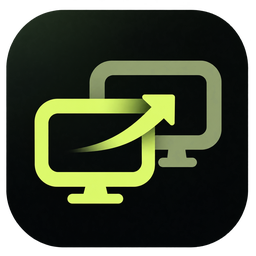
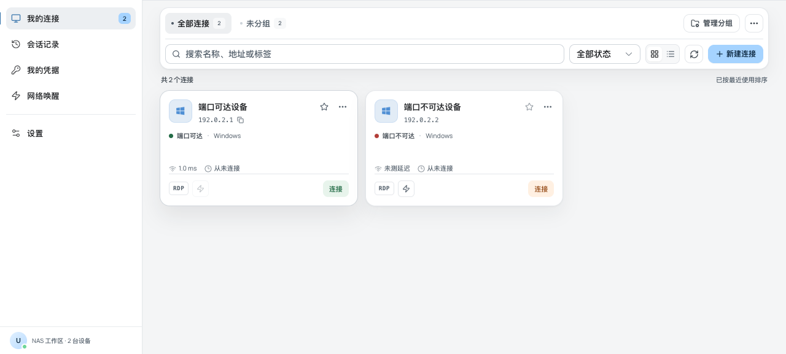

<div align="center">



# 远程桌面 for fnOS

**在浏览器中使用 Windows RDP 和 VNC 远程桌面**

把常用电脑保存为连接，在多个桌面间切换、复制粘贴内容，或在连接前唤醒局域网设备。

[](https://github.com/chenpingonline/remote-desktop-fnos/releases/latest)
[](https://github.com/chenpingonline/remote-desktop-fnos/releases)

[下载安装包](https://github.com/chenpingonline/remote-desktop-fnos/releases/latest) · [更新日志](CHANGELOG.md) · [兼容性说明](docs/COMPATIBILITY.md) · [问题反馈](https://github.com/chenpingonline/remote-desktop-fnos/issues)

</div>



## 安装与首次连接

从上方“下载安装包”进入 GitHub Releases，按 **NAS 的处理器架构**选择 FPK。安装包内置桌面引擎，无需在 NAS 上另外安装 Docker、Java 或 Node.js。

| NAS 处理器 | 安装包文件名 |
| --- | --- |
| Intel 或 AMD 64 位（x86_64） | `remote-desktop-<版本>-x86.fpk` |
| ARM 64 位（ARM64） | `remote-desktop-<版本>-arm.fpk` |

1. 在飞牛「应用中心 → 手动安装」中选择下载的 FPK。升级已有安装时，选择对应架构的新版 FPK 即可。每个包都附有同名的 `.sha256` 校验文件。
2. 在目标电脑上启用 **Windows 远程桌面（RDP）** 或 **VNC 服务（密码认证）**，并确认 NAS 能访问该电脑的服务端口。
3. 打开「远程桌面 → 我的连接 → 新建连接」，选择协议，填写名称、主机地址和端口后保存。
4. 在连接卡片上点击「连接」，按提示选择凭据或输入登录信息。首次连接自签名证书的 RDP 主机时，先核对证书指纹，再决定是否信任。

## 主要功能

| 功能 | 使用方式 |
| --- | --- |
| 多桌面切换 | 在不同标签页中操作多台电脑，可缩放、全屏、发送特殊按键或重新连接。 |
| 连接与凭据管理 | 分组、收藏和搜索常用连接，查看端口状态、延迟和会话记录。每位用户管理自己的连接，保存的凭据使用 AES-256-GCM 加密。 |
| 剪贴板共享 | 在本机与远程桌面之间复制粘贴文本。两个 Windows RDP 会话都启用文件剪贴板后，可在会话之间复制普通文件，每次最多 64 个、合计 256 MiB。 |
| 局域网唤醒 | 填写设备的 MAC 地址后，可从连接卡片或「网络唤醒」页面发送唤醒指令。广播地址默认由 NAS 选择。 |

### 连接与兼容性

- **网络路径**：浏览器通过飞牛统一网关访问应用，由 NAS 上的桌面引擎连接目标电脑。应用使用普通应用账号运行，通过私有 Unix Socket 通信，无需为应用另开公网端口。
- **连接排查**：卡片显示“端口可达”表示 NAS 可以建立 TCP 连接。若仍然无法进入桌面，RDP 请检查账号权限、凭据和证书。VNC 请确认服务端已启用密码认证。仅提供 Apple Remote Desktop 账号认证的设备需要调整认证方式。
- **验证范围**：x86 fnOS 真机已有原位升级与网关访问记录，两种架构的安装包均已在隔离 Linux 环境中验证。ARM64 fnOS 真机安装、真实 Windows RDP 和 macOS VNC 登录仍待验证。详见[验证记录](docs/TEST-RESULTS.md)和[兼容性说明](docs/COMPATIBILITY.md)。

## 升级、卸载与备份

升级时，应用先停止服务并备份数据库和配套主密钥。卸载向导默认保留数据，在**原存储空间**重装后可继续使用原有连接和凭据。选择“永久删除”会一并清除配置、数据库、日志和应用内备份。

<details>
<summary>手动备份与恢复</summary>

在 fnOS 应用目录中，`TRIM_PKGETC` 保存配置和主密钥，`TRIM_PKGVAR` 保存数据库、日志和应用内备份，`TRIM_APPDEST` 是程序目录。需要在卸载后保留独立备份时，先停止应用，使用一个位于应用目录之外的新私有目录作为备份目标：

```bash
"$TRIM_APPDEST/bin/remote-desktop" \
  --data "$TRIM_PKGVAR" \
  --key "$TRIM_PKGETC/master.key" \
  --backup /path/to/new/private-backup
```

恢复前停止应用并备份当前数据。从同一份备份恢复 `app.db` 到数据目录、`master.key` 到配置目录，确认文件属主及私有权限正确，清理旧数据库遗留的 WAL / SHM 文件后再启动。回滚程序版本时也要使用匹配的数据与密钥。

</details>

## 本地开发与打包

开发环境使用 Go（版本见 [go.mod](go.mod)）和 Node.js 22+。在仓库根目录启动本地开发服务：

```bash
export RD_DEV_TOKEN="$(openssl rand -hex 32)"
./scripts/dev.sh
```

在浏览器打开 `http://127.0.0.1:18080/app/remote-desktop/`，输入同一终端中的 `RD_DEV_TOKEN`。开发服务仅监听回环地址，数据保存在 `.data`。测试真实桌面连接时，还需在本机运行 guacd，默认地址为 `127.0.0.1:14822`。

构建 FPK 还需要 Docker 和 fnpack 1.2.3。版本取自[应用 manifest](packaging/remote-desktop/manifest)，安装包和 SHA-256 校验文件输出到 `dist/`：

```bash
./scripts/build.sh amd64
./scripts/build.sh arm64
```

<details>
<summary>运行测试</summary>

```bash
go test -race ./...
go vet ./...
npm --prefix web ci
npm --prefix web run build
python3 scripts/test-relay-ui.py
```

最后一项需要 Playwright Chromium，使用独立的本地数据、Go 服务和模拟桌面协议检查浏览器操作流程。

</details>

项目使用 Go、Vue 3 和 Apache Guacamole。第三方组件的版本、来源和许可证见[依赖说明](docs/DEPENDENCIES.md)。参与开发可参阅[需求与设计](doc/fnos_remote_desktop_development_v1.0.md)、[前端开发说明](web/README.md)、[前端迁移记录](docs/FRONTEND_MIGRATION.md)和[桌面缩放说明](docs/display-scaling.md)。
