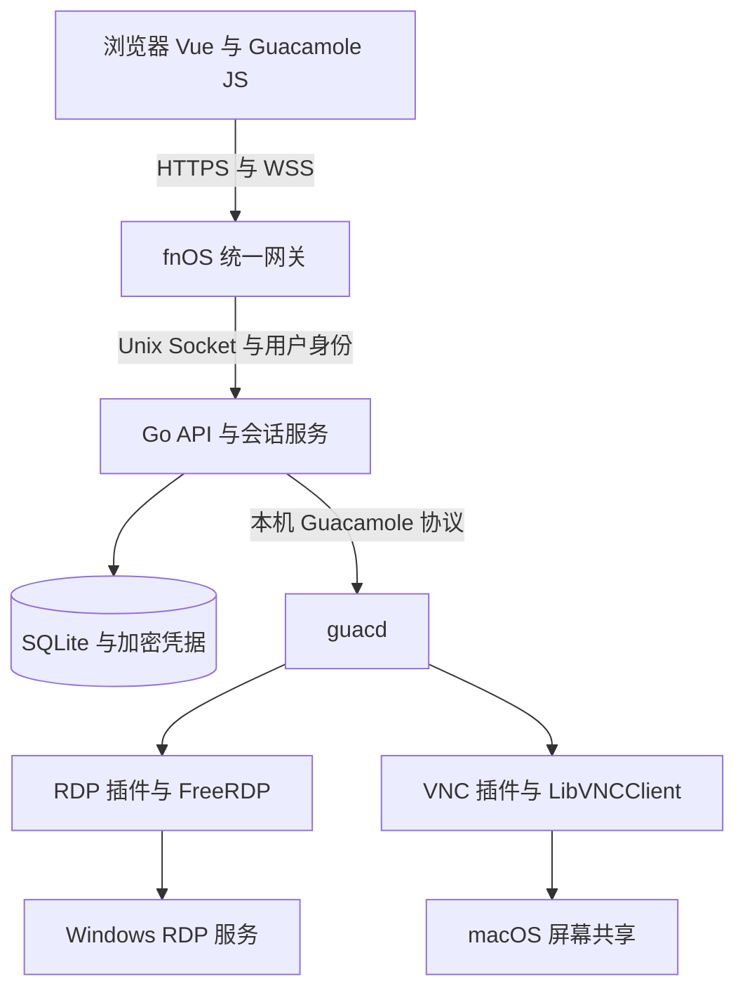
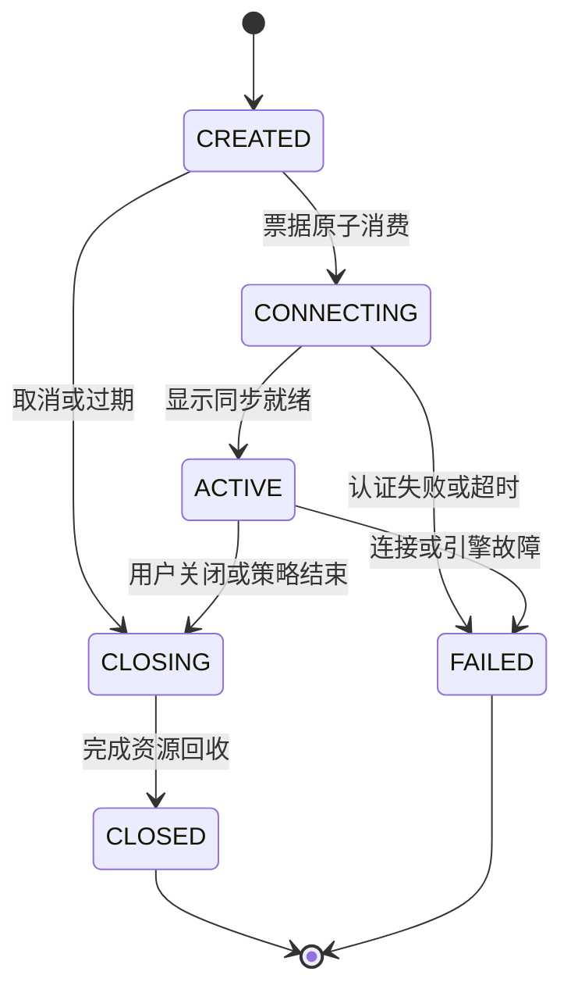

# 飞牛远程桌面应用开发文档

Windows RDP 与 macOS VNC 原生 FPK 实施方案

版本：1.0　｜　日期：2026 年 11 月 9 日　｜　状态：开发设计基线

适用读者：项目负责人、前后端开发者、构建与测试人员。项目标识暂定为 `remote-desktop`，可在立项时统一替换。

项目目标是在飞牛 fnOS 中安装一个 FPK 应用，通过浏览器管理并连接 Windows 和 Mac 桌面。建议采用 Vue 3 前端、Go 业务服务与 Apache Guacamole 原生引擎：Windows 使用 RDP，Mac 使用 VNC。应用负责身份、授权、凭据、会话与生命周期，协议引擎负责桌面连接和编码转换。

本文定义可供实现的模块边界、接口、数据结构、打包方式和验收条件。配置片段是实施示例；目标 fnOS、Windows、macOS 和浏览器的兼容组合，须按第 14 章实机验收后写入发布说明。阶段交付物均为开发目标，不代表已有实现。

## 1 实施基线与范围

### 1.1 核心决策

| 决策项 | 实施基线 | 原因与约束 |
| --- | --- | --- |
| 交付形态 | 原生 Linux 进程组成的 FPK | NAS 运行 Go、guacd 和随包原生库；运行期不依赖 Docker、Java 或 Node.js |
| 首发架构 | fnOS x86 设备 | ARM64 后续单独构建、测试和发布；远端 Mac 的 CPU 架构不决定 NAS 包架构 |
| 桌面引擎 | Apache Guacamole | 统一浏览器显示与输入；使用既有 RDP、VNC 协议实现 [1] |
| Windows 接入 | guacd RDP 插件与 FreeRDP | 对接 Windows 自带远程桌面服务 |
| Mac 接入 | guacd VNC 插件与 LibVNCClient | 对接 macOS 屏幕共享或已配置的远程管理服务 |
| 业务后端 | Go | 承担网关身份校验、授权、会话、隧道和引擎管理 |
| 状态存储 | SQLite | 单机 NAS 部署；原生依赖和 SQLite 驱动的构建方式需在 CI 中固定 |
| 身份入口 | fnOS 统一网关 | 应用仍需按用户隔离资源，不能仅依赖入口登录 [8] |

Guacamole 的浏览器客户端与 guacd 可以嵌入自研系统。采用自研 Go 后端时，需要自行实现 Web 隧道、认证、权限与管理页面；不会自动获得官方 Java Web 应用的这些功能。[1][2]

### 1.2 首版能力矩阵

| 能力 | Windows RDP | macOS VNC | 首版处理 |
| --- | --- | --- | --- |
| 桌面画面与键鼠 | 核心能力 | 核心能力 | 必须通过验收 |
| 连接分组与搜索 | 统一管理 | 统一管理 | 必须实现 |
| 多个目标标签页 | 支持多个应用会话 | 支持多个应用会话 | 受并发上限限制 |
| 全屏与画面缩放 | 浏览器实现 | 浏览器实现 | 区分缩放与远端分辨率 |
| 文本剪贴板 | 目标能力 | 兼容性有限 | Windows 验证双向文本；Mac 按实际组合开放 |
| 中文键盘输入 | 单独测试 | 单独测试 | 不以剪贴板替代所有输入场景 |
| 文件传输 | 后续使用 RDP 虚拟磁盘 | 后续增加独立 SFTP | 首版不开放 |
| 系统音频 | 后续验证 RDP 音频 | 普通 VNC 不承诺 | 首版不开放 |
| 真正的多显示器 | 单独验证 | 单独验证 | 首版单屏；标签页不等于多屏 |
| 无人值守重启后接管 | 受系统策略影响 | 受启动、权限和 FileVault 影响 | 首版要求目标系统已正常启动 |

首版不承诺游戏级延迟、4K 60 帧、HDR、Apple 高性能屏幕共享、自动公网穿透或任意多用户同时登录同一台电脑。后续能力必须单独形成验收项，不能由“引擎支持”直接推导为产品支持。

### 1.3 使用前提

浏览器必须能访问 NAS，NAS 必须能访问目标电脑的远程服务。两段网络分别验证。只有浏览器到 NAS 的远程访问正常，并不代表 NAS 能连接另一网络里的电脑。

Windows 需要支持 RDP 主机的系统版本、启用远程桌面、允许登录的账号及正确的防火墙配置。Mac 需要可用的屏幕共享或远程管理配置。目标应保持开机、网络可达，首版不内置目标端自研 Agent。[15][16]

## 2 总体架构与技术栈



### 2.1 组件职责

| 层级 | 建议技术 | 职责 |
| --- | --- | --- |
| 管理界面 | Vue 3、TypeScript、Vite、Pinia | 连接、分组、凭据元数据、设置、状态与错误展示 |
| 桌面画布 | guacamole-common-js | 绘图、键鼠、剪贴板流与桌面事件；锁定与服务端兼容的版本 [2] |
| HTTP 服务 | Go 标准库与轻量路由 | 提供静态资源和 API；统一路径前缀、请求 ID 与权限检查 |
| WebSocket 服务 | 维护中的 Go WebSocket 库 | 按 Guacamole 隧道契约转发；限制消息、缓冲和写入超时 |
| 协议适配 | 项目内 Guacamole 协议模块 | 握手、按 args 映射配置、指令解析与内部隧道指令处理 |
| 远程引擎 | guacd 与协议插件 | 把 RDP、VNC 转为 Guacamole 协议 [1][3] |
| 持久化 | SQLite 与版本化迁移 | 保存连接、凭据密文、会话元数据、审计及设置 |
| 构建交付 | Linux CI、fnpack | 编译 Go 与原生依赖、前端构建、组装 FPK、记录依赖清单 |

先固定完整可用的依赖组合，再更新单个组件。Apache Guacamole 1.6.0 可作为评估基线，其发布说明包含 FreeRDP 3 支持；最终采用的 FreeRDP、LibVNCClient 和系统库版本，应以目标 fnOS 上的完整验证为准。[7]

### 2.2 模块与源码组织

| 建议目录 | 内容 |
| --- | --- |
| `web/` | 管理页面、桌面组件、API 客户端、国际化与主题 |
| `cmd/server/` | Go 服务入口、配置装载、启动和退出顺序 |
| `internal/httpapi/` | 路由、网关身份、授权、CSRF、统一错误 |
| `internal/session/` | 会话状态机、并发配额、票据、清理与诊断 |
| `internal/guac/` | Guacamole 编解码、握手、隧道约定和流控 |
| `internal/adapter/` | RDP、VNC 参数构建；未来文件服务接口 |
| `internal/store/` | SQLite 查询、事务、迁移、备份 |
| `internal/secret/` | 凭据加解密、临时凭据、密钥版本 |
| `internal/engine/` | guacd 启停、健康、端口占用和退出处理 |
| `packaging/remote-desktop/` | FPK manifest、cmd、config、wizard、ui 与应用文件 |
| `build/` 与 `docs/` | 构建脚本、锁定依赖、兼容矩阵、运行与故障说明 |

Go 与 FreeRDP 之间通过 guacd 隔离，不要求直接使用 cgo 调用 FreeRDP。SQLite 驱动可选择纯 Go 实现，或采用已验证的 cgo 构建；选型应记录在依赖锁定清单中。

## 3 用户流程与界面行为

### 3.1 页面与操作

| 页面 | 必须提供的行为 |
| --- | --- |
| 连接列表 | 首次打开显示空状态；支持新增、分组、搜索、编辑和删除；只展示当前用户可访问的资源 |
| 连接配置 | 区分 RDP、VNC 字段；选择保存凭据或本次输入；展示默认端口及探测结果的实际含义 |
| 远程桌面 | 连接中、已连接、断开和失败状态；全屏、缩放、特殊按键、断开、重新连接 |
| 凭据管理 | 仅显示名称、类型和更新时间；允许更新、替换和删除，不提供明文读取接口 |
| 设置与诊断 | 当前版本、协议能力、会话限额、引擎状态、本人连接记录；管理员另有应用运行设置 |

首版建议使用 fnOS 应用窗口打开管理界面，并提供新标签页打开桌面。全屏与剪贴板受浏览器权限和嵌入方式影响，必须同时验证 iframe 与独立标签页。主题先实现浅色、深色和跟随浏览器；需要跟随飞牛桌面主题时，再依据实际 SDK 版本接入。

### 3.2 建立连接的产品流程

1. 用户选择已有连接。后端检查用户身份、连接归属、配置有效性和并发配额。
2. 选择“每次输入密码”时，凭据经同源 HTTPS 临时提交，得到短期引用；不写入数据库。
3. 创建应用会话，页面显示“连接中”，请求单次 WebSocket 票据。
4. WebSocket 通过认证后连接 guacd，完成协议握手和远端认证；确认协议就绪后才显示“已连接”。
5. 失败时显示可操作原因，例如目标不可达、认证失败、证书待确认或引擎未就绪；可取消连接。
6. 显式断开关闭本应用连接。重新连接创建新的应用会话；是否返回原系统桌面由 Windows 或 macOS 决定。

### 3.3 输入与剪贴板

桌面获得焦点后才捕获输入，失焦、断开或切换标签时释放已按下的键，避免 Ctrl、Alt、Command 粘住。提供 Windows 键、Command、Option、Ctrl 组合键按钮；浏览器保留的系统快捷键不能承诺全部透传。

剪贴板先实现显式的文本面板，再按浏览器授权启用自动同步。区分浏览器权限、远端协议、字符编码和目标应用四类问题。Mac 的中文输入、中文复制与双向粘贴分别验收，不能把设置 UTF-8 或增加面板视为已解决兼容性。[5][19]

## 4 会话与协议设计

### 4.1 状态机



`CREATED` 只表示会话已登记，WebSocket Upgrade 和 guacd 的 `ready` 均不足以说明远端桌面已可用。收到 `ready` 后开始正常透传，保持 `CONNECTING`；在锁定版本上验证首个有效显示同步与客户端 `CONNECTED` 状态的对应关系，以显示就绪进入 `ACTIVE`。该状态表示远程显示连接可用，不额外承诺 Windows 用户已完成所有系统登录步骤。握手中的取消也进入统一关闭流程。

应用启动时，将数据库中遗留的非终态记录标记为 `INTERRUPTED`，记录 `APP_RESTART` 原因。进程退出后，旧 socket 和票据不能恢复使用。首次实现限制一个应用会话对应一个控制隧道，避免多个浏览器竞争输入。

### 4.2 SessionContext 与资源回收

每个会话统一持有取消信号、WebSocket、guacd 连接、上下行任务、计时器、流控缓冲和配额引用。所有正常、异常及超时路径进入幂等的 `Close(reason)`。

关闭顺序为：阻止新输入和票据使用，取消连接及传输任务，关闭两侧连接，等待任务退出，释放计时器和配额，保存终态与审计。重复关闭不能重复减计数或覆盖首次有效结束原因。单个会话关闭不得重启整个 guacd。

结束原因至少包含 `USER_CLOSED`、`CANCELLED`、`TICKET_EXPIRED`、`CONNECT_TIMEOUT`、`IDLE_TIMEOUT`、`UPSTREAM_DISCONNECTED`、`PERMISSION_REVOKED`、`ENGINE_RESTART`、`APP_STOP` 和 `IO_ERROR`。

### 4.3 Guacamole 握手

Go 层建立到 guacd 的连接后，选择 `rdp` 或 `vnc`，读取 `args`，识别协议版本和参数顺序。按客户端能力发送尺寸及媒体支持信息，再按服务端返回的参数名和顺序构造 `connect`。`ready` 表示 guacd 握手完成并提供连接 ID，之后的远端认证或显示初始化仍可能失败；建连总超时必须继续覆盖这一阶段。[3][4]

不要硬编码一份固定下标数组，也不要把浏览器提供的任意参数直接转发为 guacd 配置。RDP、VNC 的参数由服务端适配器白名单生成，未知必需参数或不兼容版本必须明确失败。

### 4.4 编解码与隧道约定

Guacamole 使用长度前缀的指令流。实现流式解析，处理半包、粘包、跨读取边界的 UTF-8 字符；不能按逗号、分号直接切割。长度按锁定版本的协议字符规则计算，Go 的 `len(string)` 返回字节数，不能直接充当协议长度。[4]

使用官方 JS 客户端和 guacd 作为兼容基准，覆盖中文、组合字符和 emoji。对非法长度、超长字段、不完整指令和无效输入实行有界失败，确保无无限分配、死循环或 goroutine 泄漏。

WebSocket 协商 `guacamole` 子协议，并实现官方隧道的 UUID、内部空操作码和 ping 约定；内部指令不能无差别传给 guacd。桌面协议与业务 JSON 分开传输，业务状态通过 HTTP 轮询或独立事件通道获取。[2]

上下行必须有写超时、缓冲上限和慢客户端处理。首版可关闭音频和文件相关通道，后续启用时重新验证流大小与限额。心跳证明连接可达，不代表桌面正常，也不能作为用户操作来刷新空闲时间。

### 4.5 建议的初始运行参数

| 参数 | 开发初值 | 说明 |
| --- | --- | --- |
| 单用户并发会话 | 2 | 管理员可调；最终默认值由目标硬件压测确定 |
| 应用总并发会话 | 4 | 达到上限返回明确错误，不无限排队 |
| 一次性票据有效期 | 最长 45 秒 | 不能超过待连接会话期限；进入连接后失败则新建会话 |
| 未领取临时凭据有效期 | 60 秒 | 绑定用户和连接；创建会话时独占领取，过期删除 |
| 待连接会话有效期 | 最长 90 秒 | 使用临时凭据时不晚于其 expiresAt；签发票据不续期 |
| TCP 探测超时 | 5 秒 | 仅表示网络探测结果，不等于认证通过 |
| 远程建连总超时 | 30 秒 | 可配置；包含引擎握手与远端认证阶段 |
| 应用停止等待 | 10 秒 | 超时后清理确认属于本应用的进程树 |

这些数值是实现起点，不是性能承诺。会话最长时长、用户空闲退出与缓存上限应在压测后固化，并在设置中明确。

## 5 HTTP 与 WebSocket 接口

### 5.1 路由与通用约定

对外应用前缀为 `/app/remote-desktop`，API 前缀为 `/app/remote-desktop/api/v1`。以下表格路径相对于 API 前缀。静态资源和 WebSocket 保留同一个应用前缀，避免在统一网关下出现 404。[8]

请求和响应使用 JSON、UTF-8；时间使用 UTC RFC 3339；ID 使用不透明字符串。客户端不能指定有效 `ownerUid`。资源更新携带 `version` 做乐观并发控制，版本冲突返回 `409`。列表使用分页，不允许无界返回审计记录。

| 方法与路径 | 用途 | 核心约束 |
| --- | --- | --- |
| `GET /me` | 当前身份与角色 | 身份由可信网关确定 |
| `GET /capabilities` | 引擎与产品能力 | 区分已实现、未启用与待验证能力 |
| `GET /connections` | 连接列表 | 查询阶段按归属过滤 |
| `POST /connections` | 创建连接 | 校验协议、主机、端口和配置白名单 |
| `GET/PATCH/DELETE /connections/{id}` | 查询、编辑、删除 | 逐对象授权；删除时关闭相关活动会话 |
| `POST /connections/{id}/probe` | DNS 与 TCP 探测 | 限时、限频；不宣称登录验证成功 |
| `GET/POST /groups` | 列出与创建分组 | 仅本人；删除分组保留连接并移至未分组 |
| `PATCH/DELETE /groups/{id}` | 编辑与删除分组 | 分组和连接必须属于同一用户 |
| `GET/POST /credentials` | 元数据列表与新建 | GET 永不返回明文或可解密材料 |
| `PATCH/DELETE /credentials/{id}` | 更新或删除凭据 | 被引用时返回冲突，要求先解除引用 |
| `POST /ephemeral-credentials` | 临时输入远端凭据 | 仅内存、短期、一次使用、请求体日志脱敏 |
| `POST /sessions` | 创建待连接会话 | 仅接收连接 ID、显示参数和临时凭据引用 |
| `POST /sessions/{id}/ticket` | 签发连接票据 | 重新检查权限与状态 |
| `GET /sessions` | 本人会话列表 | 活动及历史记录分页 |
| `GET/DELETE /sessions/{id}` | 状态与结束会话 | DELETE 幂等，连接中也能取消 |
| `GET /audit-events` | 查询操作记录 | 本人范围；运维查看需独立授权 |

### 5.2 创建连接示例

```json
{
  "name": "办公 Windows",
  "protocol": "rdp",
  "targetOs": "windows",
  "host": "192.168.10.20",
  "port": 3389,
  "credentialId": "cred_example",
  "settings": {
    "security": "nla",
    "clipboard": "text",
    "certificatePolicy": "verify"
  }
}
```

`settings` 是本项目的业务模型，由后端映射为引擎参数，并非可任意透传的 Guacamole 参数集合。`targetOs` 用于界面与能力提示，`protocol` 决定实际适配器。VNC 配置包含经验证的认证模式和剪贴板编码设置，不与 Windows 域字段混用。

### 5.3 会话与票据示例

```json
{
  "connectionId": "conn_example",
  "display": { "width": 1440, "height": 900, "dpi": 96 },
  "timezone": "Asia/Shanghai",
  "ephemeralCredentialRef": null
}
```

创建结果返回 `sessionId`、`state: "CREATED"` 和过期时间。随后调用票据接口，返回 `ticket`、`expiresAt`、`webSocketPath` 与 `subprotocol: "guacamole"`。`webSocketPath` 只包含 `/app/remote-desktop/api/v1/tunnel`，不带问号和票据；官方客户端在 connect 时附加查询参数。[2]

```javascript
const tunnel = new Guacamole.WebSocketTunnel(webSocketPath);
const client = new Guacamole.Client(tunnel);
client.connect(new URLSearchParams({ ticket }).toString());
```

最终请求形如 `/app/remote-desktop/api/v1/tunnel?ticket=...`，使用同源 WSS 和网关登录态。票据为至少 256 位随机值，服务端仅保存摘要，绑定当前 fnOS 用户、会话、连接、配置与凭据版本及有效期。只对有效的 `CREATED` 会话签发，签发新票据使该会话先前未消费票据失效。

票据校验、消费和 `CREATED → CONNECTING` 必须处于同一个原子临界区。单进程 SessionManager 统一管理这一转换，使同票重放或不同票竞争同一会话时最多一个隧道成功。已进入连接流程后失败，创建新会话重试，不为 `FAILED`、`CLOSED` 或 `INTERRUPTED` 会话重新发票。

浏览器不能通过会话接口覆盖目标地址、端口、远端密码、guacd 地址或文件目录。修改连接、更新或删除凭据、撤销权限使尚未消费的票据失效。活动会话使用创建时的配置快照；应用内撤权按策略立即关闭相关会话。

查询参数中的票据必须在网关可控日志、应用日志和诊断导出中脱敏；无法控制上游日志时，应评估替代传票方式及客户端适配，不能仅脱敏 Go 日志就认为整个链路无泄露。

### 5.4 错误响应

```json
{
  "error": {
    "code": "REMOTE_AUTH_FAILED",
    "message": "远端认证失败，请检查账号或密码",
    "requestId": "req_example"
  }
}
```

建议错误码包括 `AUTH_REQUIRED`、`FORBIDDEN`、`NOT_FOUND`、`VERSION_CONFLICT`、`TARGET_UNREACHABLE`、`REMOTE_AUTH_FAILED`、`CERT_TRUST_REQUIRED`、`ENGINE_UNAVAILABLE`、`SESSION_LIMIT`、`TICKET_EXPIRED`、`EPHEMERAL_CREDENTIAL_EXPIRED`、`EPHEMERAL_CREDENTIAL_CONSUMED` 和 `PROTOCOL_ERROR`。引擎原始错误保留在脱敏诊断日志中，不直接透传完整堆栈。证书确认能力需要额外实现，第 7 章说明其边界。

## 6 数据模型与凭据

### 6.1 核心表

| 实体 | 核心字段 | 约束 |
| --- | --- | --- |
| `users` | fnos_uid、display_name、app_role、created_at、last_seen_at | 缓存外部身份，不保存 NAS 密码；禁止按用户名关联所有权 |
| `connection_groups` | id、owner_uid、name、sort_order | 首版可做单层分组，避免不必要的树结构复杂度 |
| `connections` | id、owner_uid、group_id、name、protocol、target_os、host、port、credential_id、settings_json、version | 凭据和分组引用必须属于同一用户 |
| `credentials` | id、owner_uid、name、type、ciphertext、nonce、key_id、version | 账号、域与密码统一放入加密载荷；列表只提供必要元数据 |
| `sessions` | id、owner_uid、connection_id、connection_version、state、created_at、started_at、ended_at、end_reason、request_id | 仅持久化元数据，不序列化运行中的 socket |
| `audit_events` | id、actor_uid、action、object_type、object_id、result、created_at、request_id | 无密码、键盘内容、剪贴板或可复用票据 |
| `app_settings` | key、value、version、updated_at | 仅管理员修改，返回时剔除敏感项 |
| `schema_migrations` | version、applied_at | 数据库结构版本可追踪 |

首版只支持个人连接。共享连接另增 `connection_grants`，明确查看、连接、编辑、管理权限，不能把 `allUsers: true` 作为资源共享机制。NAS 管理员的运维权限也不自动产生读取远端密码的 API。

票据和临时凭据首版放单进程内存仓库，使用随机引用的摘要索引、TTL、原子领取和定时清理。临时凭据载荷仍需要短期保存原始登录材料，不能只存密码摘要，否则无法完成远端认证。应用重启全部失效；以后若改为多实例，需要统一原子存储。

### 6.2 加密与密钥

使用 AES-256-GCM 等经过审查的认证加密算法。首次安装生成随机主密钥，存放于 `TRIM_PKGETC` 下的私有文件，权限限定应用用户读取；每条记录使用独立随机 nonce，并把 owner、凭据 ID、类型及密钥版本作为附加认证数据。

主密钥不得硬编码、写入日志或与密文放在同一数据库字段。升级和保留数据的重装必须保留原密钥；密钥轮换按 `key_id` 解密旧数据、重新加密并验证后完成切换。NAS 管理员若已掌握应用文件与运行权限，可能同时获得密钥和密文，因此不能把这种存储加密描述为抵御宿主管理员的隔离机制。

临时凭据接口返回不可猜测的 `ref` 与 `expiresAt`。创建会话时，在完成身份和连接授权后原子领取该引用，绑定唯一 `sessionId`，从公共临时仓库移除；材料转入该会话私有内存，在引擎使用后的最早安全时点释放。若创建或持久化会话失败，统一释放已领取材料及配额。

待连接会话的过期时间为创建时刻加 90 秒；使用临时凭据时取该值与凭据 `expiresAt` 的较早者。票据的过期时间不得晚于会话期限，反复取票不续期。过期、取消、失败或应用停止时统一释放材料；重复领取和过期返回对应错误。进入 `CONNECTING` 后由 30 秒建连总超时约束，避免沿用已到期的待连接计时器误杀合法建连。

临时材料不写入 URL、浏览器持久存储、数据库或请求日志。Go 内存清理应尽量缩短敏感数据寿命，但不宣称垃圾回收环境具备可证明的彻底清零。

### 6.3 SQLite 与恢复

启用外键、合理的 busy timeout 和受控写事务；选择 WAL 时，把备份与恢复流程作为同一设计。会话统计和审计按事件记录，不把每个协议包写入数据库。

升级前创建一致性备份，可使用 SQLite 备份接口，或停止写入并按数据库模式完成 checkpoint 后备份。不能直接复制正在使用的主数据库文件而忽略 WAL。数据库、主密钥、配置及其版本必须作为可恢复的一组保存。

## 7 Windows RDP 实现

### 7.1 目标端准备

Windows Professional、Enterprise、Education 和 Windows Server 可提供受支持的远程桌面主机能力；Windows Home 不作为原生 RDP 主机支持目标。用户需要启用远程桌面、授权账号、确认目标处于唤醒状态，并允许 NAS 访问 RDP 服务。[15]

默认端口为 3389，允许用户修改。账号支持用户名和可选域，明确本地账号与域账号的输入方式。密码错误、账号无登录权限、网络不可达和 NLA 协商失败应分别诊断，不统一显示为“连接失败”。

### 7.2 参数与证书

优先使用 NLA 和正常的服务器身份校验。首版稳定路径是使用能够通过校验的证书；自签名证书的指纹确认属于需要验证的扩展流程，不默认全局启用 `ignore-cert=true`。[5][15]

业务字段 `certificatePolicy=verify` 映射为正常校验，禁止忽略证书或隐式启用首次连接自动信任。明确采用的系统或应用 CA 信任来源，验证私有 FreeRDP 和加密库实际读取该来源；同时验证信任链、有效期及连接目标与证书身份匹配。无法建立可靠验证路径时明确失败，不自动降级。

如果产品要提供“信任此证书”，必须确认锁定版本的 guacd 和 FreeRDP 能向业务层提供证书信息并执行绑定校验。仅展示指纹后仍传 `ignore-cert`，不能构成真正的指纹校验。引擎接口不足时，需要明确的适配或补丁，并增加证书更换、主机改变和中间人证书用例。

推荐首版配置项为目标地址、端口、账号、域、凭据方式、初始尺寸及文本剪贴板策略。音频、磁盘重定向、打印机和多屏默认不开放，减少未验收的协议面。

### 7.3 分辨率与会话语义

浏览器缩放只改变画面展示。远端分辨率调整可依据 RDP 能力选择 display-update，或通过重新连接设置；具体路径按目标系统与引擎版本验证。[5]

关闭本应用会话仅断开 RDP 连接，不自动注销 Windows 用户。普通 RDP 的会话行为由 Windows 版本、授权和策略决定，不能承诺始终共享物理控制台，也不能把多个浏览器标签解释为无限多用户同时登录。

### 7.4 后续文件能力

后续可以启用 RDP 虚拟磁盘，将 NAS 上的应用私有目录重定向到远端。每个用户或会话使用隔离路径，配置上传大小、总配额、保留时间、取消清理和下载授权。`drive-path` 由后端生成，不能由浏览器任意指定。[5]

## 8 macOS VNC 实现

### 8.1 Mac 端准备

在 macOS“系统设置 → 通用 → 共享”中开启屏幕共享，按需要配置允许访问的用户或 VNC 查看器密码。屏幕共享与远程管理不能同时开启；已经由远程管理提供 VNC 访问的设备，应沿用其有效配置，不要求用户盲目切换服务。[16][17]

普通 VNC 接入使用 TCP 5900 作为默认端口，支持自定义。NAS 必须能访问 Mac；防火墙、休眠、网络切换和共享权限都可能影响连接。首版要求 macOS 已正常启动且共享服务可用。[16][18]

### 8.2 认证适配

| 模式 | 输入 | 实施要求 |
| --- | --- | --- |
| 标准 VNC 密码 | 单独的 VNC 密码 | 优先作为兼容性验证路径；按服务器要求配置，不复用重要账户密码 |
| Apple ARD 账号认证 | macOS 用户名和密码 | 依赖 LibVNCClient 构建与服务端协商；目标版本通过验证后才开放 |

LibVNCClient 支持的认证方式与加密依赖有关；Apple ARD 认证不能只凭填写用户名就视为可用。为每个发布版本记录 LibVNCClient、其加密后端、macOS 和认证模式组合。[20]

### 8.3 剪贴板与输入

普通 VNC 剪贴板存在字符编码和 Apple 扩展兼容问题。Apache 的相关问题记录表明，macOS 屏幕共享与第三方 VNC 客户端的剪贴板行为可能因目标应用而异；这是需要专项验证的兼容性问题，不能扩大为所有 Mac 都不支持，也不能保证切换 UTF-8 就能解决。[5][19]

测试覆盖英文、中文、emoji、换行文本，分别验证浏览器到 Mac、Mac 到浏览器，以及至少两个不同类型的 Mac 应用。对未通过的组合，在能力接口和界面关闭或标注相关功能；保留键盘输入和手动复制流程，但不承诺它们绕过服务端限制。

### 8.4 显示 音频与文件

首版提供浏览器缩放和单屏显示。改变 Mac 实际分辨率、切换多个显示器、虚拟显示器与音频均作为后续独立项目。Apple 原生高性能屏幕共享的高帧率、音频、HDR 等能力不能直接归属于普通 Guacamole VNC 连接。[21]

文件传输可在后续 P4 阶段增加 Go SFTP 服务，对接 Mac 的“远程登录”。SFTP 使用独立授权、凭据和目录策略，VNC 密码不能用于推导 SFTP 登录能力。用户无需为了桌面连接默认开放整个文件系统。[22]

### 8.5 远程访问与启动边界

浏览器到 NAS 的 WSS 只保护这一段连接。普通 VNC 的 NAS 到 Mac 链路可能缺少所需的加密保护；跨不可信网络时应使用 VPN，或经过主机密钥校验的 SSH 隧道。首版不引导用户直接把 5900 暴露到公网。[17]

休眠、合盖、锁屏、重启和 FileVault 解锁分别测试。首版不承诺预启动阶段的 VNC 解锁。Apple 对部分 Apple silicon 和新系统版本提供了特定的 SSH 解锁路径，这不代表 VNC 会自动获得同等能力，也不适用于所有 Mac 组合。[23]

## 9 飞牛原生 FPK 打包

### 9.1 包内容与运行目录

| 包内内容 | 安装后用途 |
| --- | --- |
| `manifest`、`ICON.PNG`、`ICON_256.PNG` | 应用身份、版本、架构、图标与启动入口 |
| `app/bin/` | Go 服务、guacd 和必要的原生辅助程序 |
| `app/lib/` | Guacamole 插件、FreeRDP、LibVNCClient 及私有依赖 |
| `app/web/` | 构建后的 Vue 静态文件 |
| `app/ui/config` 与图标 | fnOS 桌面入口和统一网关配置 |
| `cmd/` | main 与安装、升级、卸载、配置生命周期脚本 |
| `config/privilege`、`config/resource` | 运行身份与实际需要的资源声明 |
| `wizard/` | 安装或卸载时的必要选项与说明 |

包内 `app/` 的内容映射到应用 target 目录，运行时应通过官方变量访问，不再额外拼一层 `/app`。程序和静态资源使用 `TRIM_APPDEST`，配置与密钥使用 `TRIM_PKGETC`，数据库及持久业务数据使用 `TRIM_PKGVAR`，临时文件使用 `TRIM_PKGTMP`。[9][10]

禁止硬编码 `/vol1` 等实际卷路径。统一网关 Socket 按官方要求位于应用安装目录；业务持久数据不能因升级替换程序目录而丢失。

### 9.2 Manifest 示例

```ini
appname=remote-desktop
version=0.1.0
display_name=远程桌面
desc=通过浏览器连接 Windows 与 Mac 桌面
source=thirdparty
platform=x86
desktop_uidir=ui
desktop_applaunchname=remote-desktop.main
ctl_stop=true
checkport=false
```

示例只列关键字段，正式文件以当前 fnpack 模板及校验规则补齐维护者、图标和其他必要元数据。`platform` 使用官方枚举 `x86`、`arm`、`all`；包含架构相关二进制的包按架构分别构建，不用 `amd64` 代替 manifest 枚举，也不直接声明为 `all`。[11]

`os_min_version` 必须在完成最低版本实机验收后填写。当前统一网关文档没有明确给出其最低 fnOS 版本，不能把开放 API 的版本门槛代用为网关门槛。[8][14]

### 9.3 统一网关入口

`app/ui/config` 示例：

```json
{
  ".url": {
    "remote-desktop.main": {
      "title": "远程桌面",
      "icon": "images/icon_{0}.png",
      "type": "iframe",
      "protocol": "",
      "gatewayPrefix": "/app/remote-desktop",
      "gatewaySocket": "app.sock",
      "url": "/app/remote-desktop",
      "allUsers": true
    }
  }
}
```

Go 监听 `${TRIM_APPDEST}/app.sock`，由统一网关代理 HTTP 与 WebSocket。`gatewaySocket` 填文件名，路径以官方规则解析；服务端保留 `gatewayPrefix`。统一网关场景下 `protocol` 和 `port` 不承担传统独立端口入口的作用。不要使用不支持 WebSocket 的 CGI 入口承载远程隧道。[8][12]

`allUsers` 决定入口可见性，不授予所有用户访问同一份连接或凭据的权限。应用识别 `X-Trim-Userid`、`X-Trim-Username`、`X-Trim-Isadmin` 前，必须确认请求来自可信网关。`TRIM_UID` 和 `TRIM_USERNAME` 表示应用运行身份，与当前浏览器用户不同。[8][10]

### 9.4 权限与本机监听

`config/privilege` 首版以包用户运行：

```json
{
  "defaults": {
    "run-as": "package"
  }
}
```

桌面协议客户端通常不需要 root、TUN 或 GPU 设备权限。`config/resource` 只声明实际资源，不请求整个 NAS 的文件权限。[13]

Unix Socket 的目录和文件权限必须允许实际网关身份访问，同时限制无关进程；网关用户与应用用户可能不同，不能凭 `TRIM_UID` 推断网关权限，也不能以 `chmod 777` 代替设计。验收须证明其他不可信入口无法自行注入 `X-Trim-*` 身份。

guacd 仅绑定回环地址，使用本应用配置的私有 TCP 端口。统一网关不占外部应用端口，并不消除 guacd 的回环端口冲突。启动时检测占用、确认连接到本应用引擎，冲突则明确失败，不能误连另一应用的 guacd。

### 9.5 构建与安装示例

```bash
# 首次初始化，从仓库根目录执行
mkdir -p packaging
cd packaging
fnpack create remote-desktop
cd ..

# 后续构建与安装，从仓库根目录执行
fnpack build --directory packaging/remote-desktop
appcenter-cli install-fpk /absolute/path/remote-desktop.fpk
```

创建模板只在初始化时执行；后续构建复用版本库中的目录。实际生成文件名按 fnpack 输出为准。构建命令和安装 CLI 以锁定的工具版本验证，安装包不在目标 NAS 上临时安装编译工具或执行在线依赖下载。[24]

## 10 原生依赖与构建流水线

### 10.1 原生依赖闭包

应用包至少覆盖 guacd、RDP 和 VNC 插件、FreeRDP、LibVNCClient 及实际构建引入的 Cairo、图像、加密等依赖。Guacamole 的可选组件和依赖因编译配置而异，应按产物核对，不能仅依据一份静态清单判断完整。[3]

使用与最低目标 fnOS 兼容的 Linux ABI 构建。私有库通过受控的加载路径或相对 RPATH 加载，不覆盖系统 `/usr/lib`。除直接动态库依赖，还要验证运行时插件、证书路径和字符编码配置；单次 `ldd` 无缺失不能代替真实连接测试。

### 10.2 流水线步骤

1. 检出锁定的源代码和依赖，校验下载完整性，记录编译器、目标架构与构建参数。
2. 构建前端，将静态资源放入 FPK 应用目录；构建 Go 服务并注入版本信息。
3. 构建或导入已验证的 guacd、协议插件和原生库，设置私有加载路径。
4. 执行协议模块、会话授权和迁移等关键自动化测试，完成包结构与依赖检查。
5. 使用 fnpack 构建 FPK，生成校验值、依赖清单、许可证文件和兼容矩阵。
6. 在干净的目标 fnOS 安装，验证入口、真实 Windows 与 Mac 会话、停止、升级与恢复。

开发机可以在 macOS 上编写前端和 Go 业务。本项目统一在 Linux CI 编译和验证 guacd、协议插件及原生依赖；FPK 封装可使用对应开发平台的 fnpack。macOS 上构建 Go 或封装 FPK，不能替代目标 Linux ABI 和实机验证。ARM64 包需要完整重建原生依赖链，不能只把 Go 的 `GOARCH` 改为 arm64。

## 11 身份 授权与运行保护

### 11.1 三种身份

fnOS 登录身份决定“谁在使用应用”；应用权限决定“能访问哪些连接、凭据和会话”；远端 Windows 或 Mac 凭据决定“以哪个远端账号连接”。三者分别建模，不把 NAS 用户名自动当作远端账号。

从可信 Socket 入口读取网关身份，在所有 API、票据和隧道处执行一致授权。对象 ID 不应作为权限凭证。开发用独立 TCP 入口若保留，必须有独立的开发认证并默认关闭，不能把客户端自报的 `X-Trim-*` 当作登录结果。

### 11.2 接口和数据保护

所有写操作校验同源请求与 CSRF 防护；WebSocket 校验 Origin 和登录态。凭据仅经 HTTPS 提交；错误、访问日志与诊断包不记录密码、票据、剪贴板或按键内容。禁止把主密钥、库目录或用户任意路径暴露为下载接口。

远程连接本身是应用能力，但只有已授权的连接配置能驱动引擎。限制任意参数注入、DNS/TCP 探测频率和失败重试，按部署需要增加目标网络范围策略。后台并发、内存、上传和审计保留时间均需有上限。

### 11.3 登录失效与撤权

应用内删除连接、撤销使用权或管理员结束会话时，立即拒绝未消费票据并按策略关闭活动会话。仅在 WebSocket 握手时校验 NAS 登录态，不足以证明已建立长连接会随 NAS 注销即时失效。

若飞牛提供适用的登录态复核或注销事件接口，可按正式契约接入；否则明确采用会话最长时长、应用内主动断开和重新建连认证。发布说明应描述实际行为，不能承诺未经验证的 NAS 注销即时联动。

### 11.4 日志与诊断

审计记录连接配置变更、凭据更新、会话创建和结束、策略拒绝、引擎退出、应用升级等事件。诊断至少包含 request ID、会话 ID、阶段、错误类别和耗时；地址与用户名按诊断用途和用户授权最小化展示。

监测 Go 与 guacd 健康、活动会话数、建连成功率和耗时、进程 RSS、CPU、网络流量、异常关闭和磁盘空间。健康检查不以“PID 文件存在”判定正常；界面应显示引擎不可用，避免持续转圈。

## 12 生命周期 升级与恢复

### 12.1 进程管理

`cmd/main` 实现幂等的 start、stop、status。start、stop 成功返回 0，失败返回 1；status 在运行时返回 0，未运行时返回 3。重复停止已经停止的应用视为成功。相关安装、升级、卸载及配置脚本按官方生命周期接入，用户可见错误写入 `TRIM_TEMP_LOGFILE`。[9][10]

建议 Go 服务负责以前台模式启动 guacd，记录确切的进程身份并监测退出。guacd 可能为会话产生子进程，停止时要覆盖属于本应用的进程树。不得使用宽泛的 `pkill -f guacd` 清理其他应用。

引擎意外退出后，将受影响会话结束，按有上限的退避策略重启引擎。故意停止、升级和卸载时禁止自动重启。Go 自身异常退出后的恢复，由经目标 fnOS 验证的托管机制或本应用受控监督程序承担，不能默认主进程退出就会被系统自动拉起。

### 12.2 启动与停止顺序

启动时检查目录和权限，读取配置与密钥，验证数据库版本，清理已确认失效且属于本应用的 Socket，标记遗留会话中断，启动引擎并验证健康，最后开放业务请求。

停止时先拒绝新会话和新票据，通知并关闭现有会话，等待受控任务退出，停止引擎进程树，安全关闭数据库并移除本应用 Socket。重复 start 不产生第二套进程，重复 stop 不误报其他进程为本应用。

### 12.3 升级 备份与回滚

升级前验证剩余空间，停止写入或执行一致性备份，保存数据库、密钥及配置版本，执行事务化迁移，启动并健康检查。迁移失败保留诊断和原备份，不继续接收会话。

回滚必须同时满足旧程序与数据格式兼容。存在不兼容迁移时，应恢复升级前匹配的数据和密钥；仅换回旧二进制不构成完整回滚。卸载向导如提供保留数据选项，应同时保留解密所需密钥，并通过实际卸载重装验证目录保留行为。

## 13 开发阶段与交付物

按风险依赖推进，不在尚未跑通网关和原生引擎前投入完整界面开发。每个阶段以可演示产物和测试记录结束，工期在第一阶段完成后按实际工程量估算。

| 阶段 | 工作内容 | 阶段交付与通过条件 |
| --- | --- | --- |
| P0 兼容性验证 | 在目标 fnOS 验证 Unix Socket 网关、身份 Header、WSS、私有库；跑通一台 Windows 和一台 Mac | 最小 FPK、固定版本清单、截图或日志证据；明确最低 fnOS 候选版本与 Mac 认证模式 |
| P1 核心后端 | SQLite 迁移、连接和凭据、授权、票据、状态机、Go 隧道、引擎管理 | API 可用；用户隔离、票据重放、取消与资源清理测试通过 |
| P2 可用界面 | 连接管理、桌面页面、状态和错误、特殊键、剪贴板面板、设置 | 完整 Windows 流程；Mac 在已验证组合下完成桌面与输入；无虚构预置连接 |
| P3 FPK 发布准备 | 生命周期、升级备份、恢复、限额、诊断、干净设备验证 | 可重复构建的 FPK、用户指南、兼容矩阵、已知限制和回滚方案 |
| P4 后续能力 | 文件传输、RDP 音频、共享授权、ARM64、更多显示能力 | 每项独立实现和验收，不延迟首版核心链路 |

P0 必须先确认三个问题：最低候选 fnOS 的网关行为、完整原生依赖在干净系统上的运行、Mac 的真实认证与剪贴板边界。如果其中任何一个未通过，调整对应方案和发布范围后再进入后续阶段。

## 14 验收与测试矩阵

### 14.1 环境记录

每次发布记录 fnOS 版本、NAS CPU 与内存、包架构、Go、guacd、FreeRDP、LibVNCClient、加密后端、Windows 或 macOS 版本、认证模式、浏览器及网络条件。未测组合标为“待验证”，不由相邻版本自动推导为支持。

最低建议覆盖两种 Chromium 浏览器环境及 Safari；具体版本在发布时锁定。测试有线局域网、受控高延迟链路和断网重连，分别记录浏览器到 NAS、NAS 到目标的延迟与带宽。

### 14.2 必须通过的功能与异常用例

| 编号 | 场景 | 通过标准 |
| --- | --- | --- |
| A01 | 两个 fnOS 用户隔离 | 不能列出、读取、修改或连接对方的私有对象 |
| A02 | 伪造身份和绕过网关 | 不可信入口无法获得其他用户身份 |
| A03 | 票据过期、重放、跨用户和并发消费 | 同票或不同票竞争同一会话，都最多一个隧道成功 |
| A04 | 发票据后改配置、删凭据或撤权 | 旧票据失效；活动会话按声明策略结束 |
| A05 | 覆盖主机、密码、路径、guacd 参数 | 服务端拒绝未知或越权字段 |
| A06 | 临时凭据竞争、过期、领取后取消 | 同引用最多一个会话领取；所有结束路径释放材料和配额 |
| P01 | 中文、emoji、半包、粘包和畸形长度 | 编解码正确或有界失败，无资源失控 |
| P02 | args 参数重排或可选项变化 | 依参数名正确映射，不错位传递凭据 |
| P03 | ready 后认证失败或一直无显示同步 | 不提前显示成功，建连总超时仍然生效 |
| S01 | DNS、TCP、握手、认证阶段取消 | 及时终止，配额、socket、任务均回收 |
| S02 | 断开、刷新、关闭标签和浏览器崩溃 | 会话最终结束，不意外注销远端系统用户 |
| S03 | guacd 或 Go 异常退出 | 界面状态收敛；旧会话和票据不复活 |
| W01 | Windows 正常登录及错误凭据 | 桌面可操作；错误类别可解释 |
| W02 | 证书链、有效期、目标身份和证书变更 | 合法且身份匹配才通过；过期、不可信、名称不符或绑定不符均拒绝 |
| M01 | Mac VNC 密码与 ARD 认证 | 对声明支持的模式分别验证并记录依赖组合 |
| M02 | Mac 中英文输入与双向剪贴板 | 按应用和字符类型记录能力，失败功能有明确降级 |
| U01 | 特殊按键、失焦、缩放和全屏 | 无粘键；iframe 与新标签行为符合说明 |
| L01 | 安装、重复启动、停止、NAS 重启 | 无重复实例、孤儿进程或错误归属清理 |
| L02 | 端口冲突、Socket 权限、磁盘满 | 明确失败并可诊断，不误连其他引擎 |
| D01 | 升级、迁移失败、回滚和保留数据重装 | 原凭据可解密、归属不变、数据版本匹配 |
| R01 | 限额、慢客户端和连续失败 | 资源有界；关闭后回到合理基线 |
| R02 | 日志、URL、导出与数据库检查 | 无明文远端密码和可复用票据泄露 |

文件和音频启用后另加大流量、路径隔离、配额、取消清理及浏览器兼容测试。首版未实现的能力不放入首版通过清单。

### 14.3 性能与长时间运行

在明确的硬件与网络条件下，测量建连耗时、输入反馈、画面更新、单会话和总 CPU、RSS 与流量。以空闲桌面、文本编辑和页面滚动作为首版基线；视频播放用于观察极限，不转化为未验证的产品承诺。

至少完成一次持续工作时段运行、反复连接断开和接近并发上限的测试，观察内存和句柄是否持续增长。首版并发默认值由这些数据确定，不仅依据单次连接成功。

## 15 发布前待关闭事项

| 项目 | 决策或验证结果要求 |
| --- | --- |
| 最低 fnOS 版本 | 实机通过统一网关 HTTP、WSS、身份与 Socket 权限后填写 os_min_version |
| 原生依赖组合 | 锁定 guacd、FreeRDP、LibVNCClient、加密后端和 Linux ABI；干净系统验证 |
| Windows 自签名证书 | 确定首版是否支持可信导入或真实指纹绑定；不接受虚假的信任交互 |
| Mac 认证模式 | 每个支持版本分别记录 VNC 密码和 ARD 的结果；未通过模式不展示为支持 |
| Mac 剪贴板 | 明确中英文、方向、目标应用的边界，并同步能力接口与用户说明 |
| NAS 注销联动 | 确认是否有正式复核机制，否则采用明确的会话时长与重新认证规则 |
| 引擎恢复与回滚 | 验证 Go 自身托管、guacd 子进程清理、不兼容迁移恢复 |
| 许可证与分发内容 | 随包保存实际组件许可证、版权声明和需要提供的材料；按实际链接与分发方式审查 |

首版完成定义为：可重复构建和安装的 x86 FPK；两个 NAS 用户相互隔离；Windows 和已声明的 Mac 组合能够建立可用桌面；异常连接可清理；停止、升级与恢复通过；用户说明与实际能力一致。

## 16 参考资料

以下为官方开发文档、项目源码或项目问题记录。版本敏感内容应在实现和发布时重新核对；问题记录用于识别测试风险，不代替支持声明。

1. Apache Guacamole 架构。https://guacamole.apache.org/doc/gug/guacamole-architecture.html
2. Apache Guacamole JavaScript API 与 WebSocketTunnel 源码。https://guacamole.apache.org/doc/gug/guacamole-common-js.html ； https://guacamole.apache.org/doc/guacamole-common-js/main_webapp_modules_Tunnel.js.html
3. Apache Guacamole 原生组件构建。https://guacamole.apache.org/doc/gug/guacamole-native.html
4. Apache Guacamole 协议。https://guacamole.apache.org/doc/gug/guacamole-protocol.html
5. Apache Guacamole 连接参数。https://guacamole.apache.org/doc/gug/configuring-guacamole.html
6. Apache Guacamole 使用与剪贴板。https://guacamole.apache.org/doc/gug/using-guacamole.html
7. Apache Guacamole 1.6.0 发布说明。https://guacamole.apache.org/releases/1.6.0/
8. 飞牛统一网关注册。https://developer.fnnas.com/docs/core-concepts/gateway-registration/
9. 飞牛应用框架与生命周期。https://developer.fnnas.com/docs/core-concepts/framework/
10. 飞牛环境变量。https://developer.fnnas.com/docs/core-concepts/environment-variables/
11. 飞牛 Manifest。https://developer.fnnas.com/docs/core-concepts/manifest/
12. 飞牛应用入口。https://developer.fnnas.com/docs/core-concepts/app-entry/
13. 飞牛权限配置。https://developer.fnnas.com/docs/core-concepts/privilege/
14. 飞牛开发文档更新记录。https://developer.fnnas.com/docs/update-log/
15. Microsoft 启用远程桌面。https://learn.microsoft.com/en-us/windows-server/remote/remote-desktop-services/remotepc/remote-desktop-allow-access
16. Apple 开启或关闭 Mac 屏幕共享。https://support.apple.com/zh-cn/guide/mac-help/mh11848/mac
17. Apple 配置 VNC 访问。https://support.apple.com/en-lb/guide/remote-desktop/apde0dd523e/mac
18. Apple 产品使用的 TCP 与 UDP 端口。https://support.apple.com/zh-cn/103229
19. Apache GUACAMOLE-2299 macOS VNC 剪贴板问题记录。https://issues.apache.org/jira/browse/GUACAMOLE-2299
20. LibVNC 项目源码与认证能力说明。https://github.com/LibVNC/libvncserver
21. Apple 高性能屏幕共享。https://support.apple.com/zh-cn/guide/mac-help/mchl1883115d/mac
22. Apple 允许远程登录以使用 SSH 和 SFTP。https://support.apple.com/zh-cn/guide/mac-help/mchlp1066/mac
23. Apple FileVault 部署说明。https://support.apple.com/guide/deployment/intro-to-filevault-dep82064ec40/web
24. 飞牛 fnpack 与 appcenter-cli。https://developer.fnnas.com/docs/cli/fnpack/ ； https://developer.fnnas.com/docs/cli/appcentercli/
